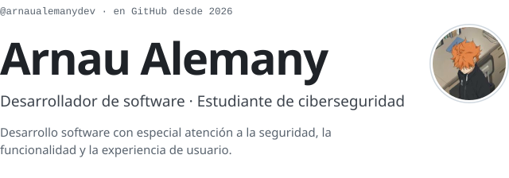
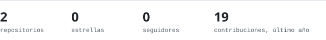
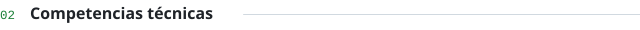
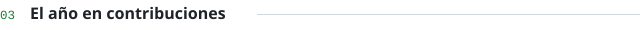

<!-- Generated by scripts/build.mjs. Edit profile.config.json, not this file. -->

<a href="README.md">EN</a> · <b>ES</b>

<picture>
  <source media="(max-width: 600px) and (prefers-color-scheme: dark)" srcset="assets/generated/header-es-dark-m.svg">
  <source media="(max-width: 600px)" srcset="assets/generated/header-es-light-m.svg">
  <source media="(prefers-color-scheme: dark)" srcset="assets/generated/header-es-dark.svg">
  
</picture>

<picture>
  <source media="(max-width: 600px) and (prefers-color-scheme: dark)" srcset="assets/generated/stats-es-dark-m.svg">
  <source media="(max-width: 600px)" srcset="assets/generated/stats-es-light-m.svg">
  <source media="(prefers-color-scheme: dark)" srcset="assets/generated/stats-es-dark.svg">
  
</picture>

<h3>
<picture>
  <source media="(max-width: 600px) and (prefers-color-scheme: dark)" srcset="assets/generated/section-work-es-dark-m.svg">
  <source media="(max-width: 600px)" srcset="assets/generated/section-work-es-light-m.svg">
  <source media="(prefers-color-scheme: dark)" srcset="assets/generated/section-work-es-dark.svg">
  
</picture>
</h3>

<picture>
  <source media="(max-width: 600px) and (prefers-color-scheme: dark)" srcset="assets/generated/project-1-es-dark-m.svg">
  <source media="(max-width: 600px)" srcset="assets/generated/project-1-es-light-m.svg">
  <source media="(prefers-color-scheme: dark)" srcset="assets/generated/project-1-es-dark.svg">
  
</picture>

[Repositorio](https://github.com/ArnauAlemanyDev/Zent) · [Demo](https://arnaualemanydev.github.io/Zent/)

<h3>
<picture>
  <source media="(max-width: 600px) and (prefers-color-scheme: dark)" srcset="assets/generated/section-skills-es-dark-m.svg">
  <source media="(max-width: 600px)" srcset="assets/generated/section-skills-es-light-m.svg">
  <source media="(prefers-color-scheme: dark)" srcset="assets/generated/section-skills-es-dark.svg">
  
</picture>
</h3>

<picture>
  <source media="(max-width: 600px) and (prefers-color-scheme: dark)" srcset="assets/generated/skills-es-dark-m.svg">
  <source media="(max-width: 600px)" srcset="assets/generated/skills-es-light-m.svg">
  <source media="(prefers-color-scheme: dark)" srcset="assets/generated/skills-es-dark.svg">
  
</picture>

<h3>
<picture>
  <source media="(max-width: 600px) and (prefers-color-scheme: dark)" srcset="assets/generated/section-year-es-dark-m.svg">
  <source media="(max-width: 600px)" srcset="assets/generated/section-year-es-light-m.svg">
  <source media="(prefers-color-scheme: dark)" srcset="assets/generated/section-year-es-dark.svg">
  
</picture>
</h3>

<picture>
  <source media="(max-width: 600px) and (prefers-color-scheme: dark)" srcset="assets/generated/year-es-dark-m.svg">
  <source media="(max-width: 600px)" srcset="assets/generated/year-es-light-m.svg">
  <source media="(prefers-color-scheme: dark)" srcset="assets/generated/year-es-dark.svg">
  
</picture>

<h3>
<picture>
  <source media="(max-width: 600px) and (prefers-color-scheme: dark)" srcset="assets/generated/section-connect-es-dark-m.svg">
  <source media="(max-width: 600px)" srcset="assets/generated/section-connect-es-light-m.svg">
  <source media="(prefers-color-scheme: dark)" srcset="assets/generated/section-connect-es-dark.svg">
  
</picture>
</h3>

**GitHub** · [github.com/ArnauAlemanyDev](https://github.com/ArnauAlemanyDev)  
**Correo** · [arnau.alemany.espert@gmail.com](mailto:arnau.alemany.espert@gmail.com)
