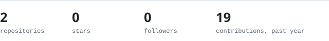
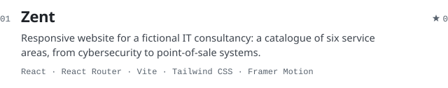
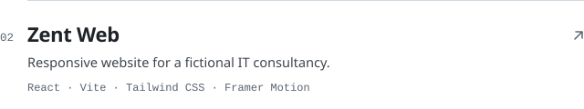
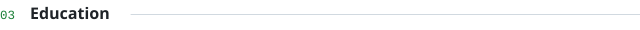
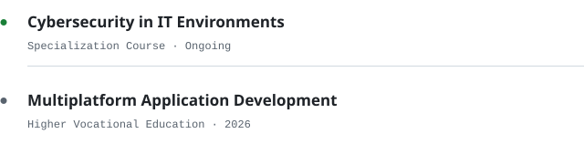
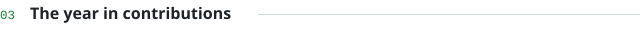
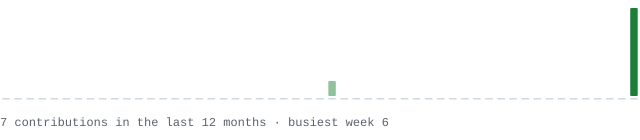
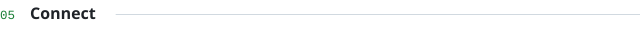

<!-- Generated by scripts/build.mjs. Edit profile.config.json, not this file. -->

<b>EN</b> · <a href="README.es.md">ES</a>

<picture>
  <source media="(max-width: 600px) and (prefers-color-scheme: dark)" srcset="assets/generated/header-en-dark-m.svg">
  <source media="(max-width: 600px)" srcset="assets/generated/header-en-light-m.svg">
  <source media="(prefers-color-scheme: dark)" srcset="assets/generated/header-en-dark.svg">
  
</picture>

<picture>
  <source media="(max-width: 600px) and (prefers-color-scheme: dark)" srcset="assets/generated/stats-en-dark-m.svg">
  <source media="(max-width: 600px)" srcset="assets/generated/stats-en-light-m.svg">
  <source media="(prefers-color-scheme: dark)" srcset="assets/generated/stats-en-dark.svg">
  
</picture>

<h3>
<picture>
  <source media="(max-width: 600px) and (prefers-color-scheme: dark)" srcset="assets/generated/section-work-en-dark-m.svg">
  <source media="(max-width: 600px)" srcset="assets/generated/section-work-en-light-m.svg">
  <source media="(prefers-color-scheme: dark)" srcset="assets/generated/section-work-en-dark.svg">
  
</picture>
</h3>

<a href="https://github.com/ArnauAlemanyDev/Zent-ERP">
<picture>
  <source media="(max-width: 600px) and (prefers-color-scheme: dark)" srcset="assets/generated/project-1-en-dark-m.svg">
  <source media="(max-width: 600px)" srcset="assets/generated/project-1-en-light-m.svg">
  <source media="(prefers-color-scheme: dark)" srcset="assets/generated/project-1-en-dark.svg">
  
</picture>
</a>

<a href="https://github.com/ArnauAlemanyDev/Zent-Web">
<picture>
  <source media="(max-width: 600px) and (prefers-color-scheme: dark)" srcset="assets/generated/project-2-en-dark-m.svg">
  <source media="(max-width: 600px)" srcset="assets/generated/project-2-en-light-m.svg">
  <source media="(prefers-color-scheme: dark)" srcset="assets/generated/project-2-en-dark.svg">
  
</picture>
</a>

<h3>
<picture>
  <source media="(max-width: 600px) and (prefers-color-scheme: dark)" srcset="assets/generated/section-skills-en-dark-m.svg">
  <source media="(max-width: 600px)" srcset="assets/generated/section-skills-en-light-m.svg">
  <source media="(prefers-color-scheme: dark)" srcset="assets/generated/section-skills-en-dark.svg">
  
</picture>
</h3>

<picture>
  <source media="(max-width: 600px) and (prefers-color-scheme: dark)" srcset="assets/generated/skills-en-dark-m.svg">
  <source media="(max-width: 600px)" srcset="assets/generated/skills-en-light-m.svg">
  <source media="(prefers-color-scheme: dark)" srcset="assets/generated/skills-en-dark.svg">
  
</picture>

<h3>
<picture>
  <source media="(max-width: 600px) and (prefers-color-scheme: dark)" srcset="assets/generated/section-education-en-dark-m.svg">
  <source media="(max-width: 600px)" srcset="assets/generated/section-education-en-light-m.svg">
  <source media="(prefers-color-scheme: dark)" srcset="assets/generated/section-education-en-dark.svg">
  
</picture>
</h3>

<picture>
  <source media="(max-width: 600px) and (prefers-color-scheme: dark)" srcset="assets/generated/education-en-dark-m.svg">
  <source media="(max-width: 600px)" srcset="assets/generated/education-en-light-m.svg">
  <source media="(prefers-color-scheme: dark)" srcset="assets/generated/education-en-dark.svg">
  
</picture>

<h3>
<picture>
  <source media="(max-width: 600px) and (prefers-color-scheme: dark)" srcset="assets/generated/section-year-en-dark-m.svg">
  <source media="(max-width: 600px)" srcset="assets/generated/section-year-en-light-m.svg">
  <source media="(prefers-color-scheme: dark)" srcset="assets/generated/section-year-en-dark.svg">
  
</picture>
</h3>

<picture>
  <source media="(max-width: 600px) and (prefers-color-scheme: dark)" srcset="assets/generated/year-en-dark-m.svg">
  <source media="(max-width: 600px)" srcset="assets/generated/year-en-light-m.svg">
  <source media="(prefers-color-scheme: dark)" srcset="assets/generated/year-en-dark.svg">
  
</picture>

<h3>
<picture>
  <source media="(max-width: 600px) and (prefers-color-scheme: dark)" srcset="assets/generated/section-connect-en-dark-m.svg">
  <source media="(max-width: 600px)" srcset="assets/generated/section-connect-en-light-m.svg">
  <source media="(prefers-color-scheme: dark)" srcset="assets/generated/section-connect-en-dark.svg">
  
</picture>
</h3>

<a href="mailto:arnau.alemany.espert@gmail.com">
<picture>
  <source media="(prefers-color-scheme: dark)" srcset="assets/generated/connect-email-en-dark.svg">
  
</picture>
</a>
